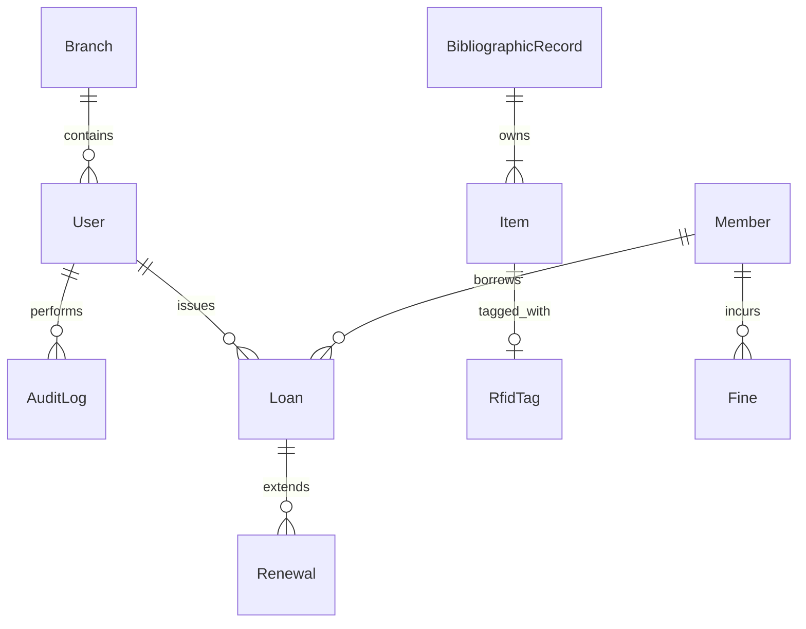

# Architecture Package (D2)

## Layered Architecture Overview

The system strictly adheres to the required multi-tier layered architecture to isolate responsibilities, support offline capabilities, and enable clean mocked integrations.

### 1. Presentation Layer
- **Web Interface:** Server-side rendered Jinja2 templates (HTML/CSS/JS).
- **Theme:** Glassmorphism aesthetic, accessible CSS design system.
- **REST APIs:** FastAPI endpoints consumed by internal UI and future external integrations.

### 2. Application Layer
- **Framework:** FastAPI (Python 3.11+ async).
- **Use-Case Services:** Circulation logic (`app.api.v1.circulation`), catalogue search, RBAC, etc.
- **Security:** JWT-based stateless authentication (`app.core.security`).

### 3. RFID Middleware Layer
- **Role:** Bridges logical operations (checkout, inventory) with physical hardware events.
- **Design Pattern:** Strategy/Adapter Pattern for hardware neutrality (`app.rfid.adapters.base.BaseRfidAdapter`).
- **Implementations:** 
  - Real deployments inject concrete device SDKs.
  - Candidate prototype injects `MockGateAdapter`, `MockSmartCardAdapter`, etc., producing identical event outputs as real hardware.

### 4. Data Layer
- **Engine:** PostgreSQL 16 (via asyncpg and SQLAlchemy ORM).
- **Search:** Native PostgreSQL Full-Text Search (TSVECTOR) to avoid relying on external search indexing services in an offline environment.
- **Models:** Denormalised models for performance (e.g., accumulated fines on member).
- **Audit Logging:** Immutable append-only logging of every administrative action (`app.models.audit.AuditLog`).

### 5. Integration Layer
- **Third-Party Mocks:** Email (SMTP), SMS, CCTV image extraction, print queues.
- **ILMS Protocols:** Extensible NCIP 2.0 / SIP2 stubs prepared within the RFID middleware structure.

### 6. Operations Layer
- **Configuration:** Strict separation using `pydantic-settings` reading from environment variables.
- **Observability:** Structured JSON logging via `structlog`, `/health` endpoints.
- **Migrations:** Alembic versioned schema controls ensuring zero-data-loss upgrades and controlled rollback.
- **Containerisation:** Docker Compose prepared for isolated environment deployment.

## Logical Data Model (Simplified)

## Security & Deployment Topologies

- **Offline Isolation:** Built to operate entirely without internet access. Docker images, offline pip wheels, and full-text search within PostgreSQL make this possible.
- **Credential Protection:** Passwords securely hashed (bcrypt), JWT tokens have configurable expiries, secrets managed via `.env` excluding them from source control.
- **RBAC:** Roles (Super Admin, Librarian, Circulation Staff, etc.) dictate route access and UI visibility.
